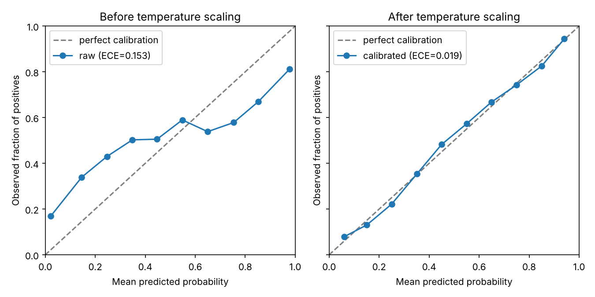

# calibkit

[](https://github.com/<your-username>/calibkit/actions/workflows/ci.yml)
[](LICENSE)

A small, dependency-light Python toolkit for **measuring and improving the probability
calibration of binary classifiers**. It was written as a practical module for scientific work
in medical machine learning, where a predicted "0.9" must really mean "about 9 out of 10 such
patients are positive" before a clinician can rely on it.

## Features

- **Metrics:** Expected Calibration Error (ECE), Maximum Calibration Error (MCE), Brier score.
- **Reliability statistics:** per-bin counts, mean confidence and observed accuracy.
- **Recalibration:** `TemperatureScaler` (post-hoc temperature scaling fitted by minimising
  negative log-likelihood on a validation set; ranking of predictions is preserved).
- **Visualisation:** reliability diagrams (optional `matplotlib`).
- **CLI:** `calibkit report predictions.csv` prints metrics before and after scaling.

## Installation

```bash
git clone https://github.com/<your-username>/calibkit.git
cd calibkit
pip install -e ".[plot]"      # library + plotting
pip install -e ".[dev]"       # + pytest, coverage, ruff
```

Requires Python 3.10+.

## Quick start

```python
import numpy as np
from calibkit import TemperatureScaler, expected_calibration_error

# y_val, p_val: validation labels (0/1) and the model's predicted probabilities
scaler = TemperatureScaler().fit(y_val, p_val)
p_test_cal = scaler.transform(p_test)

print("ECE before:", expected_calibration_error(y_test, p_test))
print("ECE after: ", expected_calibration_error(y_test, p_test_cal))
```

Reliability diagram:

```python
from calibkit.plotting import plot_reliability_diagram
plot_reliability_diagram(y_test, p_test_cal, n_bins=10, label="my model")
```

Run the bundled demo (synthetic over-confident classifier):

```bash
python examples/demo.py
```

Typical output:

```
Fitted temperature: 3.05
ECE   before 0.1532 -> after 0.0186
Brier before 0.2043 -> after 0.1782
```



### Command line

Input CSV needs the columns `y_true` (0/1) and `y_prob` (probability of the positive class):

```bash
calibkit report predictions.csv --bins 10
```

## How the metrics work

Predictions are split into equal-width probability bins. For each bin the mean predicted
probability (*confidence*) is compared with the observed fraction of positives (*accuracy*):

- **ECE** = Σ (n_bin / N) · |accuracy − confidence|
- **MCE** = max over bins of |accuracy − confidence|
- **Brier** = mean (p − y)²

Temperature scaling computes `sigmoid(logit(p) / T)`, with a single scalar `T > 0` fitted on
held-out data. `T > 1` softens over-confident models.

## Project layout

```
src/calibkit/    metrics.py, scaling.py, plotting.py, cli.py
tests/           pytest suite (100% line coverage)
examples/        demo.py
docs/            TECHNOLOGY_CHOICES.md
.github/         CI/CD workflow, issue and PR templates
```

## Development

```bash
pip install -e ".[dev]"
ruff check .
pytest
```

Every push and pull request runs lint + tests on Python 3.10–3.13 via GitHub Actions
(`.github/workflows/ci.yml`). Pushing a tag such as `v0.1.0` additionally builds the
package and publishes a GitHub Release with the wheel and sdist attached.
See [CONTRIBUTING.md](CONTRIBUTING.md) and [docs/TECHNOLOGY_CHOICES.md](docs/TECHNOLOGY_CHOICES.md).

## Limitations

- Binary classification only; no multiclass or multimodal-specific calibration yet.
- Equal-width binning: ECE depends on the number of bins and is noisy for small samples.
- Temperature scaling cannot fix miscalibration that varies non-monotonically with confidence.

## References

- Guo, C., Pleiss, G., Sun, Y., Weinberger, K. Q. *On Calibration of Modern Neural Networks.*
  ICML 2017.
- Brier, G. W. *Verification of forecasts expressed in terms of probability.*
  Monthly Weather Review, 1950.
- Naeini, M. P., Cooper, G., Hauskrecht, M. *Obtaining Well Calibrated Probabilities Using
  Bayesian Binning.* AAAI 2015.

## License

[MIT](LICENSE)
